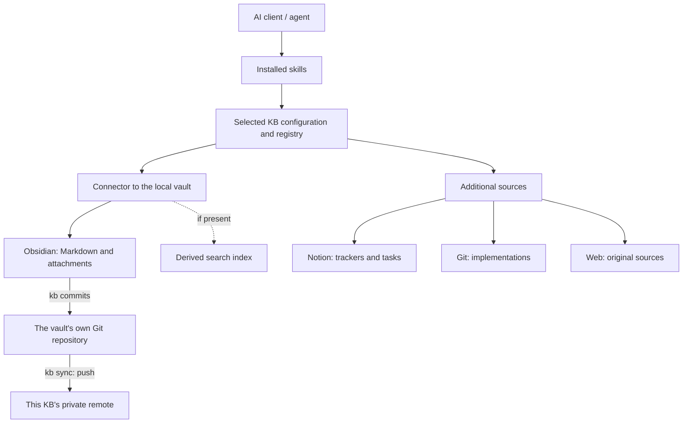
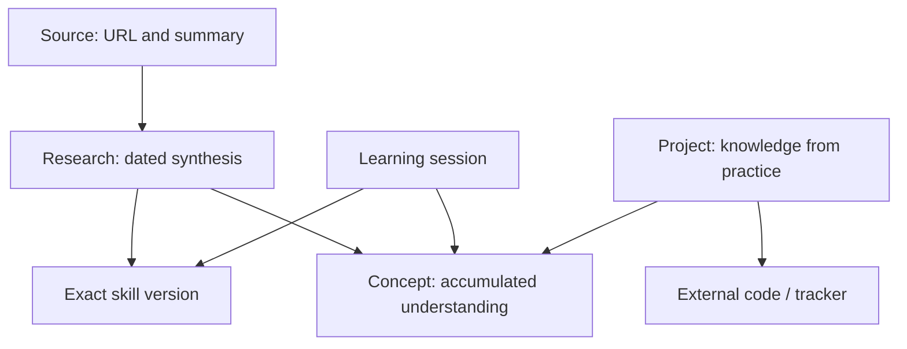

# Personal Knowledge System — Design & Contracts v1.14

> **Superseded** by [personal-knowledge-design-v2.md](personal-knowledge-design-v2.md) (2026-10-12). This version is kept as the history of the MVP decisions for roadmap stages 0–4.

## 1. Purpose and status

This document summarizes the discussed architecture: entities, component boundaries, Markdown file content, knowledge provenance, how agents work, package delivery and data storage. It complements `personal-knowledge-user-stories-v1.md` version 1.7 and describes the system without the user story format.

**Agreed** — a direction or behavior accepted in the discussion. **Example** — an illustration of such behavior, not a final data schema, API or command. **Open** — a technical decision that is yet to be made.

Exact directory names, YAML fields, commands, search models and integrations are not yet approved. The structures below make already discussed ideas concrete and do not add new mandatory technologies. The system is not implemented yet; the existence of a contract does not mean a working connection exists.

## 2. Key decisions

1. **Obsidian is the canonical store of accumulated knowledge.** Markdown notes, their metadata and attachments make up the user data.
2. **Notion, Git/GitHub and the Web are additional sources and functionality.** Statuses and tasks stay in the tracker, implementations in the repository, originals of external materials at their source links.
3. **Useful summaries and knowledge are saved to the knowledge base.** A link with a short summary is acceptable; copying a source in full is not required by default.
4. **Skills define the working rules.** An integration/connector/MCP provides access; the registry explains the purpose of sources to the agent.
5. **Context is retrieved selectively.** A brief learning profile and relevant notes are used instead of loading the whole vault.
6. **The project is delivered as an installable package with skills.** Source code, versions and CI are maintained on GitHub.
7. **The package and the knowledge bases are independent.** One local installation serves several separately initialized knowledge bases with their own settings.
8. **Skills are available in the user scope.** They can be used outside the project repository in supported clients.
9. **The vault is stored locally and has its own history and copy** (revised in v1.12). The vault root is a separate Git repository, never the package repository; its off-machine copy is a push to a private remote dedicated to the vault. Two-way sync between devices comes after the MVP (§12).
10. **The provenance of results is recorded.** The skill used and its version, the date and the sources can be determined; a later update is distinguishable from the original creation.

Central principle: **Obsidian stores knowledge, not the world.**

### 2.1. MVP decisions (v1.1)

11. **One user.** The author installs the package from their GitHub repository and updates it to new versions. The "another user" and "multiple knowledge bases" scenarios are not implemented in the MVP, but the architecture does not rule them out.
12. **Python + `uv`.** The package is a Python project; installation and updates from GitHub via `uv` (for example, as a `uv tool`; the specific command is not approved).
13. **Clients: Claude Code, Codex, Cursor.** All three have access to local files and a shell, so for one's own vault the MVP does without an MCP connector: the agent reads and writes Markdown directly and calls the package CLI. ChatGPT is excluded from scope (v1.5); notes on possible paths are in §12.2.
14. **Skills in a common format + installation adapters.** Skills are written once in a portable format (`SKILL.md`). Each client has its own installation method: for example, a Claude Code plugin, a user skills directory, entry instructions. The clients' current mechanisms are verified at the start of implementation.
15. **Writes only on explicit command.** Knowledge is saved when the user invokes the `add-knowledge` skill (working name); see §11.2.
16. **A new knowledge base from scratch.** There is no existing vault; the package creates one with an initialization command.
17. **Local vault with its own Git history and a push to a private remote** (v1.2–v1.4, revised in v1.12). Notes are always written to a local folder outside any synced folder. `kb` commits to the vault's own Git repository after every write; `kb sync` commits outside edits and pushes to a private remote dedicated to the vault (any Git host; never the package repository), hourly and on demand. Time Machine is the independent local copy. The MVP goal is to survive accidental deletion and loss of the computer; other cloud copies (Google Drive, snapshot backups) and phone access come after the MVP. Scheme — §12.
18. **Installation: a Python package that installs the skills itself** (v1.3). First install — `uv tool install` from GitHub, then `kb setup`; updating — a single command, `kb update`. Client plugins are not used in the MVP. Scheme — §4.1.
19. **Obsidian is not required for the package to work** (v1.3). The package and agents work with Markdown files directly; Obsidian is for the human to read and navigate, and can be installed at any time (§2.2).

### 2.2. What a vault is

An Obsidian vault is an ordinary folder with Markdown files and attachments. On first open, Obsidian creates a service folder `.obsidian/` in it with the app's settings. There is no special format or database: everything in the folder is notes, and they can be read and edited without Obsidian. Initializing the KB in this project means creating such a folder with the structure, templates, learning profile and configuration, plus its own Git repository for history (§12.1); the off-machine copy is set up separately (§12.3). In Obsidian, the folder is opened via "Open folder as vault".

There is no need to install Obsidian in advance: `kb init`, skills and agents (Claude Code, Codex, Cursor) read and write files without it. Obsidian adds convenience for the human: clickable `[[wiki-links]]`, Graph View, Canvas, rendering of Mermaid and attachments. Without it, notes remain plain Markdown that can be opened in any editor.

## 3. Components and their boundaries

| Component | Responsibility | What is not automatically attributed to it |
|---|---|---|
| Package repository | Source code, skills, templates, documentation, versions, CI | Storing users' personal knowledge |
| Installed package | Reusable tools for initializing and working with a KB | A separate copy of the source code for each knowledge base |
| User skills scope | Access to installed rules from different working directories | Automatic delivery of these rules to all AI clients |
| KB instance | Local vault, its own configuration and connections | Data shared with all other instances |
| Source Registry | Purpose of sources and choosing context for a task | Installing integrations or granting access |
| Skill | When to search, what to read, how to summarize and update | Technical implementation of file access |
| Connector / MCP integration | Client access to the corresponding knowledge base or external service | Mandatory presence of semantic search |
| Retrieval | Finding the right notes/fragments | Canonical storage of knowledge in place of Markdown |
| Search index, if used | A derived representation for search | An irreplaceable sole copy of knowledge |
| Vault history and remote copy | The vault's own Git repository and its private remote (§12) | Storing the vault in the package repository; two-way sync between devices (after the MVP) |
| AI client / agent | Choosing operations, reading context and producing results according to the rules | Access to local data without the corresponding connection |

**Context Router** is the name discussed for the context selection logic. For now it is a role in the workflow, not a decision to create a separate service, class or agent.



The diagram shows logical dependencies, not a mandatory order in which every component is called. The agent consults additional sources as needed.

## 4. Package and knowledge base instances

### 4.1. Package delivery

The project repository maintains the library, the bundled skills, initialization tools, configuration templates/examples and documentation. The package is installed locally at a chosen version.

Installing the package and creating a knowledge base are different operations. The user installs the tools, then creates a new KB or connects an existing vault. Creating a second KB does not require a second installation of the package.

**Chosen scheme (v1.3).** The package is a Python project installed via `uv` as a tool with a CLI (provisional name `kb`). The package consists of two parts: a CLI for deterministic operations (init, search, note validation, maintenance) and skills (`SKILL.md`) with rules for the agent. The CLI itself installs the skills into the clients. Separate plugins for Claude Code, Codex and Cursor are not made in the MVP; a Claude Code plugin can be added later as an additional installation method from the same repository.

The commands below are illustrative; names are not approved:

| Action | Commands | What happens |
|---|---|---|
| First install | `uv tool install git+https://github.com/<owner>/<repo>`, then `kb setup` | The CLI is installed; `setup` asks which clients to install skills into and creates/connects the vault. Two steps are needed because `uv` does not run actions after installation |
| Update | `kb update` | One command: runs `uv tool upgrade`, then reinstalls the skills with the new version into all clients chosen during `setup` |
| Check | `kb doctor` | Shows the CLI version and the skills versions in each client, reports discrepancies and what to do |
| Specific version / rollback | `uv tool install --force git+…@vX.Y.Z`, then `kb setup` | The chosen tag is installed |

Skills installation decisions:

- **Skills are copied, not linked.** This way new skills from a new version are delivered, removed ones are cleaned up, and links do not break when a path inside the `uv` environment changes, for example when Python is updated.
- **The CLI manages only its own skills.** It keeps a list of the skills it installed and does not touch other skills in the clients' folders.
- **The package version is written into the skill copy.** The agent knows which version of the rules it is working with and writes it to provenance (§7). If the skill and CLI versions diverge (for example, the package was updated directly via `uv tool upgrade`), the skill warns about it before writing.
- User skills directories for each client are recorded in [clients-v0.md](clients-v0.md) (stage 0): `~/.claude/skills/` for Claude Code and `~/.agents/skills/` for Codex; Cursor reads both.
- If the repository is private, installation requires access to it (SSH or a GitHub token).

### 4.2. Logical contract of a KB instance

For each instance, the following are distinguishable:

| Part | Content |
|---|---|
| Instance selection | A name/identifier or another unambiguous way to select a KB |
| Local vault | Location of Markdown files and attachments |
| User configuration | Settings of this knowledge base and its sources |
| Connectors | Connections for working with this knowledge base and its supporting sources |
| History and copy | This knowledge base's Git repository and its remote |
| Learning context | A brief profile and detailed notes |
| Derived state | Index/sync state, if used |

This list defines what an instance consists of, but does not prescribe placing each part in a specific file.

**Configuration example; field names and values are provisional:**

```yaml
kb:
  name: ai-learning
  vault_path: /home/example/Knowledge/ai-learning

source_registry: /home/example/KnowledgeConfig/ai-learning/sources.yaml

connector:
  provider: "<chosen-integration>"

sync:
  provider: git
  remote: "<private-remote-of-this-vault>"
```

Access settings are set by the user. They are not distributed with the package source code. Another knowledge base uses a different vault and its own configuration. For any read/write operation it must be unambiguous which instance is selected; searching across all knowledge bases by default is not intended.

### 4.3. The other-user scenario

Another user gets the same package from the GitHub project, installs the skills, creates/connects their own KB and configures their own connectors and storage. Neither the author's personal vault nor their accounts are needed for this.

Logical sequence: **install a package version → initialize or connect a vault → configure sources and synchronization → install/connect skills to the client → verify access to the selected KB**. This describes the process, not ready-made CLI commands.

## 5. Knowledge base entities

### 5.1. Base note types

| Type | Purpose | Example content |
|---|---|---|
| `source` | Representation of an external source | URL, short summary, key takeaways, why it was saved |
| `research` | A dated synthesis of several sources | Comparison, table, conclusions, limitations, links |
| `concept` | Accumulated understanding of a concept | Explanation of RAG, links to retrieval and reranking |
| `learning-session` | Outcomes of a specific study session | Topics studied, recorded conclusions, remaining questions |
| `project` | Knowledge about a practical project | Goal, rationale for decisions, lessons learned, links to code/tracker |

`insight` was discussed as a useful observation from practice. **Decided in v1.7:** it is not a sixth type; insights go in an `## Insights` section of a `concept` or `project` note ([note-schema-v0.md](note-schema-v0.md) §2).

The type defines the purpose of the material, not necessarily a separate folder. Sources can be listed directly in a research note: a separate `source` note for each link is not required.

### 5.2. Links between entities

Links can exist as wiki-links and metadata. Discussed so far: topical relatedness (`related`), dependencies (`depends_on`), sources (`sources`), project context and a reference to the rules used for creation.



This is a semantic model of links. It does not require Neo4j and does not mean that an arbitrary YAML field is automatically shown in Graph View. The concrete representation of machine-readable links and their visualization are still being chosen; wiki-links are used for navigation between notes.

## 6. Markdown file contract

### 6.1. General shape

A note consists of metadata and readable Markdown text. The text can contain tables, wiki-links, Mermaid and links to attachments. A reader should understand the main meaning without having to reconstruct it from a search index.

Semantic parts of the contract:

| Part | Discussed meaning |
|---|---|
| Type | The note's purpose, one of the five base types |
| Title | A clear title for the material |
| Dates | Creation and update; the date a piece of research applies to |
| Topics/tags | Search and topical grouping |
| Provenance | Skill, the version used and a link to the exact rules |
| Sources | Links to external materials or related source notes |
| Links | Related concepts, research and project context |
| Body | Own summary, synthesis, explanation or session outcomes |

Mandatory fields per type, their names and the nesting schema are defined in [note-schema-v0.md](note-schema-v0.md) (v1.7). Agent/model/template metadata is allowed when known; missing values are not invented. Skill provenance applies to results processed through a skill and must not be fabricated for manually written material.

### 6.2. Example source note

The content below is illustrative: the URL points to a placeholder source and does not confirm any real research.

```markdown
---
type: source
title: "Agent Memory Architectures"
url: "https://example.org/agent-memory"
created: "2026-10-05"
updated: "2026-10-05"
topics:
  - agent-memory
  - rag
created_by:
  skill: research-summary
  skill_version: "1.2"
  skill_ref: "<link-to-exact-rules-version>"
---

# Agent Memory Architectures

## Summary

A short summary, in my own words, of the approach described in the source.

## Key takeaways

- How the approach differs from what I have already studied.
- Which limitations are worth checking.

## Why I saved it

The material is useful for researching agent memory architecture.

## Source

[Original material](https://example.org/agent-memory)

## Related

- [[Agent Memory]]
- [[RAG]]
```

What is stored here is a representation of the source, not its full text. To check the current state of the material, the agent opens the original.

### 6.3. Example research note

```markdown
---
type: research
title: "Agent Memory — comparison"
created: "2026-10-05"
updated: "2026-10-05"
topics:
  - agent-memory
created_by:
  skill: research-synthesis
  skill_version: "2.1"
  skill_ref: "<link-to-exact-rules-version>"
---

# Agent Memory — comparison

## Question and scope

How do the approaches under study differ in storage and retrieval?
The comparison applies to the stated date and the selected sources.

## Comparison

| Solution | Storage | Retrieval | Basis |
|---|---|---|---|
| Approach A | Per A's documentation | Per A's documentation | Link A |
| Approach B | Per B's documentation | Per B's documentation | Link B |

## Findings

Conclusions from the comparison, with assumptions marked.

## Limitations and open questions

What has not been verified and which questions remain.

## Sources

- [[source-approach-a]]
- [Approach B documentation](https://example.org/approach-b)

## Related

- [[Agent Memory]]
```

The table illustrates the shape of a synthesis and makes no claims about specific products. The research is tied to a date; durable conclusions can extend a concept note.

### 6.4. Examples of the other types

| Note | Possible sections | Content boundary |
|---|---|---|
| `concept`: RAG | Explanation, retrieval diagram, limitations, related concepts, basis | Accumulated understanding; dated comparisons go in a separate research note |
| `learning-session`: an MCP session | Topics, conclusions, what remained unclear, related notes | Records the session; does not attribute unconfirmed understanding to the user |
| `project`: Personal Knowledge Agent | Goal, decisions and reasons, knowledge gained, external links | Does not duplicate the issue tracker, source code and current PRs |

### 6.5. Visual content

The discussed split: text — Markdown; architecture diagrams — Mermaid; images/screenshots — attachments; topic overview — Canvas; links — Graph View. Excalidraw is possible as an extra and is not required.

Example image link: `![[rag-architecture.png]]`. When necessary, the important meaning of a picture is explained in text. Markdown text, a diagram and an image complement each other; the agent having access to the text does not imply it automatically understands every attachment.

The directory names below serve only as a placement example:

| Part of the vault | Example |
|---|---|
| Concepts | `concepts/RAG.md` |
| Short source cards | `sources/source-approach-a.md` |
| Syntheses | `research/agent-memory-comparison.md` |
| Learning outcomes | `learning-sessions/2026-10-05-mcp.md` |
| Project knowledge | `projects/personal-knowledge-agent.md` |
| Attachments | `attachments/rag-architecture.png` |
| Brief profile | `learning_profile.md` |

## 7. Provenance and versions contract

Provenance answers the questions: which sources the result was derived from, which skill and which version of it processed the material, when it was created/updated, and where to read the rules that were used.

Discussed so far: `skill`, `skill_version`, a link to the exact skill version, dates and sources. Additional `agent`, `model`, `template_version`/config are allowed when reliable values exist. The version number is recorded as a string; the values in the examples do not denote existing skills of the project.

The original creation and subsequent transformations are distinguishable. **An illustration, not an approved log format:**

```yaml
created_by:
  skill: research-synthesis
  skill_version: "2.1"
  skill_ref: "<exact-rules-v2.1>"

updates:
  - date: "2026-10-05"
    skill: research-synthesis
    skill_version: "3.0"
    skill_ref: "<exact-rules-v3.0>"
```

A link to a mutable "current skill" does not explain the rules of an old note. **Decided in v1.7:** `skill_ref` links to the `SKILL.md` file at the package's Git release tag; no separate snapshots are kept ([note-schema-v0.md](note-schema-v0.md) §3).

| Version | What it denotes |
|---|---|
| Package version | A release of the library, distribution and installation tools |
| Skill version | The rules of a specific knowledge transformation |
| Configuration schema version | Compatibility of a KB instance's settings |
| Note version/history | Changes to the content of a specific piece of material |
| Design document version | The state of recorded agreements |

These versions are not interchangeable. The skill itself + provenance provide traceability of rules and sources; they do not guarantee bit-for-bit reproduction of an LLM response. **Decided in v1.12:** note content history is the vault's Git repository, one commit per `kb` write with provenance in Git trailers (§12.1).

## 8. Source registry contract

The registry separates the primary knowledge base from supporting sources. It explains where to go for a specific fact and how to reconcile results in case of conflict.

**An example registry, developing the discussed `sources.yaml`; not a final schema:**

```yaml
knowledge_base:
  provider: obsidian
  role: canonical_knowledge
  priority: primary
  access:
    method: "<local-or-mcp>"
    connector: "<connection-to-selected-kb>"
  use_for:
    - concepts
    - research
    - learning_history
    - project_knowledge

supporting_sources:
  tracking:
    provider: notion
    role: operational
    access:
      method: mcp
      connector: "<user-connection>"
    resource: "<id-of-the-relevant-tracker>"
    use_for:
      - application_status
      - tasks
      - trackers

  code:
    provider: github
    role: operational
    resource: "<repository-with-implementation>"
    use_for:
      - source_code
      - issues
      - pull_requests
      - implementation_state

  web:
    role: external
    use_for:
      - current_information
      - documentation
      - research_sources
```

Listing a source does not create a connection, grant permissions or guarantee that the needed tool is available. The registry belongs to the configuration of a specific KB; the distributed package contains only an example.

### 8.1. Authority rules

| Fact requested | Primary basis for the answer |
|---|---|
| What the user has already studied and which questions they recorded | Notes/learning profile of the selected KB |
| Accumulated explanation and the reasons for a decision | The corresponding note in Obsidian |
| Current status of a job application or task | The corresponding tracker |
| How the implementation is structured right now | Code/state of the corresponding repository |
| Current documentation or state of an external product | The original, up-to-date source |

Obsidian's priority is the priority of the knowledge base within the system, not a rule to trust an outdated summary over the current state of an external service. For a mixed request, knowledge and current context are combined with distinguishable provenance.

### 8.2. Links to external context

A project or research note can specify related external resources.

```yaml
type: project
topics:
  - personal-knowledge-system
external_context:
  github:
    repo: "<implementation-repository>"
    issue: "<related-issue>"
  notion:
    project: "<related-project-or-tracker>"
```

Such a link connects knowledge with practice. It does not mean copying the content of the issue/tracker into Obsidian.

## 9. Skills, connectors and entry instructions contract

A skill defines a scenario: when to look for past knowledge, which sources to use, how to produce a summary/synthesis, how to update an existing note and record provenance. A specific split into learning/research/job-search/software-project skills was discussed as an option, not as an approved list of what ships.

A possible declaration of skill dependencies:

```yaml
required_sources:
  - tracking
optional_sources:
  - knowledge_base
```

This is an example of context requirements for an operational task, not the final `SKILL.md` format. Source names must correspond to the registry of the selected knowledge base. A skill does not assume access to a source just because it is listed in YAML.

Entry instructions point the agent to the rules and the registry. `AGENTS.md` was discussed; how it is loaded depends on the AI client. A new agent must receive the instructions and the technical connections, not just a file name.

The gist of the discussed entry instruction:

> To work with the user's knowledge, select a KB and read its source registry. Use Obsidian as the canonical knowledge layer. For current statuses, tasks and implementation, go to the corresponding supporting sources. Do not duplicate their content in the KB; save useful synthesis and knowledge with provenance.

Local skills are installed into the user scope and can be used in different repositories. For ChatGPT/a remote client, a way to deliver these rules and access to the selected knowledge base are needed separately. Neither universal support for `AGENTS.md` nor automatic access to the local vault is assumed.

**MVP (v1.1, refined in v1.5):** skills and the CLI work in Claude Code, Codex and Cursor. ChatGPT is out of scope (§12.2). Skills find the vault through the package's user configuration, not through the current working folder: a skill can be invoked from any repository. The installation mechanism for each client is implemented as a separate adapter; specific directories and plugin formats are verified during implementation.

### 9.1. AI component architecture (v1.6)

The solution is built on **skills + CLI**. MCP, subagents and hooks are not used in the MVP, but the architecture allows adding them without reworking the core.

**Separation principle:** everything that can be checked by code is done by the CLI; everything that requires understanding text is done by a skill (LLM).

| Layer | Responsibility | MVP |
|---|---|---|
| Core: Python library + `kb` CLI | Locating the vault via configuration, search by frontmatter and text, creating/extending notes from templates, **stamping provenance** (skill, version, date), schema validation, duplicate detection, skills installation, synchronization | Yes |
| Skills (`SKILL.md`) | Summarizing the conversation, classifying by type, the "create or extend" decision, wording the text, marking confirmed vs. assumed | Yes: `add-knowledge`, `kb-recall` |
| Global instruction (`AGENTS.md` / `CLAUDE.md` / Cursor user rules) | A short pointer telling the agent that the knowledge base exists and which skills apply | Yes: a block between `<!-- ms-kb:begin/end -->` markers in `~/.claude/CLAUDE.md` and `$CODEX_HOME/AGENTS.md`, written by `kb setup` / `kb install-skills`; for Cursor the text is printed to paste into User Rules (v1.11, [clients-v0.md](clients-v0.md) §2) |
| MCP server | The same core operations as typed tools for clients without a shell (ChatGPT, phone, remote agents) | No; a thin wrapper over the core later |
| Subagents | A "librarian" (searching a large vault and returning only the needed fragments), parallel reading of sources for `research` | No; an optional improvement for clients that support them |
| Hooks | For example, a "save knowledge?" reminder before context compaction (PreCompact in Claude Code); automatic writing is not allowed | No; an optional improvement |

Important constraints:

- **Provenance is stamped by the CLI, not the model.** The skill, version and date values come from the installed package, which rules out invented metadata (US-12).
- **A subagent does not see the main conversation.** The summary for `add-knowledge` is produced only by the main agent; source search and reading can be delegated to subagents.
- **Skills are written to degrade gracefully:** if subagents or hooks are not available in a client, the skill performs the steps itself.
- **The CLI writes the notes (decided in v1.8).** The skill passes the content to `kb new` / `kb extend`; the CLI renders the note, stamps provenance, validates it and only then writes it. `kb extend` only appends to sections and lists, so existing text is never rewritten. The agent does not edit note files with its own tools.

## 10. How the agent reads context

1. Determines the task and the selected KB.
2. For personal/learning context, finds the profile and relevant knowledge; for an operational fact, selects a supporting source via the registry.
3. Searches for relevant notes/fragments by text, metadata, types and links; semantic search is possible if a corresponding backend exists.
4. Reads the material found, not the whole vault.
5. If needed, gets up-to-date information from an external source.
6. Forms an answer taking what was found into account and flags unavailable/unverified context.

| Request | Expected context selection |
|---|---|
| "Let's continue studying Transformers" | Learning profile, concept notes and past learning-session notes |
| "Which approaches to agent memory have I researched?" | Primarily research notes on the corresponding topic |
| "What's the application status and what did we decide about the strategy?" | Status from Notion plus knowledge/conclusions from Obsidian |
| "What is 15 × 18?" | No additional KB search is needed |

The learning profile is a small context with current directions, known topics, recently studied material and open questions. It links to detailed notes and does not replace them. **Decided in v1.11:** the profile is loaded **on demand** — the `kb-recall` skill reads it first when the request needs personal learning context; the global instruction only names the skills and does not load the profile, so a simple question reads nothing from the KB. `add-knowledge` fills it (recent sessions, new concepts, open questions); it stays append-only user data, and `kb doctor` warns when it grows past ~150 lines so the user trims it ([note-schema-v0.md](note-schema-v0.md) §5).

Retrieval describes the process of extracting context and does not imply mandatory use of embeddings. Text/semantic/hybrid search and the specific backend for the first implementation are open. Third-party Obsidian plugins mentioned earlier were examples of possible implementations; none of them is chosen by this document.

## 11. How the agent saves and updates knowledge

1. Determines whether the result is knowledge, a short source card, research, a session summary or operational state.
2. For knowledge, searches for existing material in the selected KB.
3. Creates a new note or extends a suitable one without repeating what is already written.
4. Preserves links/basis and processing provenance; contradictions are distinguishable from the previous conclusion.
5. If a search index exists, updates it for the changed content.
6. `kb` commits the changed files to the vault's Git history right after the write; the push to the remote runs on a schedule and via `kb sync`, never synchronously with a write (§12.1, §12.3).

| Input result | Placement |
|---|---|
| An article worth remembering | URL and own summary in a `source` |
| A comparison of several sources | A dated `research` with links |
| A durable explanation | Creating/extending a `concept` |
| A session summary and remaining questions | `learning-session`, plus the profile if needed |
| A new task/application status | The corresponding external system |
| A confirmed conclusion from practice | A knowledge note referencing the external basis |

**Write policy (decided in v1.1):** writing happens only on explicit skill invocation by the user. The invocation itself is the permission to write. The agent does not create or change notes on its own initiative, and there is no automatic saving. **Decided in v1.8:** new notes are created right away; before extending existing notes, the skill shows a plan (note, sections, what is added) and waits for the user's confirmation.

Filtering by skill/version makes it possible to find old materials. Updating with a new skill or with current sources keeps the original creation and the new processing distinguishable. Automatic regular rebuilds of all research are not approved.

### 11.1. Logical access operations

The capabilities discussed are **search, read, create/update/merge**. This is a contract for the purpose of the operations, not a ready MCP schema:

| Operation | Meaning |
|---|---|
| Search | Find suitable materials in the selected KB, taking available filters into account |
| Read | Get the content of a selected note or fragment |
| Create | Create new material in the corresponding knowledge base |
| Update/merge | Add/revise knowledge in existing material according to the skill's rules |
| Init | Create a separate instance with its configuration or connect an existing vault |
| Sync | Commit outside edits and push the knowledge base's history to its remote |
| Restore | Return a deleted or damaged note from history (a user command, not exposed to skills) |

Exact tool names, arguments, response formats and the split between the library and an existing plugin have not yet been chosen. It is not assumed that an installed third-party connector already provides all these operations.

### 11.2. The `add-knowledge` skill: saving conversation outcomes

The main MVP scenario (US-24): the user spends a long time working through a topic in a chat and at the end invokes `add-knowledge` to collect the result into the knowledge base.

1. **Collection.** The agent goes through the conversation (in full or for a specified topic) and extracts: the original question, explanations and conclusions, comparisons, mentioned sources, open questions. Unconfirmed points are marked as assumptions.
2. **Classification.** The material is distributed by type: the summary — `learning-session`; a durable explanation — `concept`; a dated comparison — `research`; significant external material — `source` or a link within a note.
3. **Searching for existing notes.** For each topic the agent searches for notes in the vault (via the package CLI or file search) and chooses between "create" and "extend".
4. **Writing.** Creating new notes and extending existing ones without repetition, with frontmatter, wiki-links and provenance (`created_by` or an entry in `updates`).
5. **Report.** The agent lists the created and changed files. Updates the learning profile if needed.

Limitation: the agent sees only what is currently in its context. If the client has compacted a long conversation (context compaction), early details may be available only in abbreviated form. Whether to take into account transcripts saved by the client (if they exist on disk) is an open implementation question.

A single run can create several notes: for example, a `learning-session` + extending two `concept` notes + one `source`.

## 12. Storage, history and GitHub's roles

**Decided in v1.12** after the roadmap stage 4 research. The local vault remains the working copy of the knowledge: agents and the CLI write only to it. Its protection is split into three needs, decided separately:

| Need | MVP decision | After the MVP |
|---|---|---|
| Change history and restore | The vault root is its own Git repository; `kb` commits after every write (§12.1) | — |
| Off-machine copy | `kb sync` pushes that repository to a private remote dedicated to the vault; Time Machine is the independent local copy (§12.3) | A second cloud copy: snapshot backup or Google Drive (§12.5) |
| Multi-device / two-way sync | Not in the MVP | One two-way mechanism, for example Obsidian Sync; Git stays one-way (§12.5) |

Principles behind the decision:

- **Sync is not backup.** A two-way sync client (iCloud Drive, Google Drive for desktop, Dropbox, OneDrive) propagates a local deletion or corruption to the cloud within seconds; recovery is then limited to the provider's trash, about 30 days on free tiers. A mirror that repeats deletions does not count as an independent copy.
- **At most one two-way mechanism per vault.** Two two-way mechanisms on the same folder conflict (Obsidian's own guidance). History and the off-machine copy are therefore strictly one-way: commits and pushes leave the Mac, nothing is pulled back. This keeps the single two-way slot free for a future phone.
- **The vault lives outside synced folders.** Not in iCloud Drive, Google Drive, Dropbox or OneDrive folders, and not in `~/Documents` or `~/Desktop` when iCloud "Desktop & Documents" is on (the default `~/Knowledge/main` is fine). Inside iCloud, "Optimize Mac Storage" can replace a note with an `.icloud` placeholder, a `.git` folder there is a known source of corruption, and moving to Obsidian Sync later requires leaving iCloud anyway.
- **Only `kb` changes the vault and runs Git in it.** Skills never delete, move or rename vault files and never run Git there (§12.4).

The index, if one is used later, is derived state that can be rebuilt from the notes; it is never committed or copied as canonical knowledge. Indexes, configuration and history of different instances are not mixed.

**GitHub's roles.** The v1.2 exclusion of GitHub ("the vault is not stored in any repository") is revised. Its reason was not recorded; on the merits, a private Git host and Google Drive both see the plaintext, so privacy does not favor either, while Git gives diffs, history and restore of a plain-Markdown vault for free. The goal the exclusion protected — never mixing package code and personal data — is kept: the vault has its own repository, never the package repository.

| Role | What is stored | Relation to the KB |
|---|---|---|
| Repository of the distributed package | Library code, skills, templates, CI | Tools that work with the KB; never contains notes |
| Supporting code source | Code/issues/PRs of a practical project | External basis for project knowledge; the KB holds only links and conclusions |
| Possible host of the vault's remote | The vault's own private repository | The off-machine copy (§12.3); any Git host works, GitHub is one option |

### 12.1. Vault history: a separate Git repository (v1.12)

**Repository.** `kb init` makes the vault root a Git repository of its own, both for a new vault and for an existing one, and writes a `.gitignore` that excludes Obsidian's churn and temporary files: `.obsidian/workspace*.json`, `.obsidian/cache`, `.trash/`, `.DS_Store` and `kb`'s own temporary files. If the vault is inside a *foreign* work tree (a repository whose root is not the vault root, for example a project repository), `kb init` does not create a nested repository and `kb doctor` warns; a vault whose root is its own repository is the normal state.

**A commit per write.** Every `kb new` / `kb extend` ends with a commit:

1. Before writing, if the work tree has changes made outside `kb` (Obsidian, the file manager), `kb` commits them separately with `git add -A` and a message such as `external: 3 files changed outside kb`. A half-finished user edit never ends up in an agent's commit.
2. `kb` writes the note and commits **only its own paths** (`git add -- <paths>`). The subject is `kb: create|extend <path>`; Git trailers carry provenance: `Kb-Skill`, `Kb-Skill-Version`, `Kb-Version` and `Kb-Agent` when it is known (§7).

The history becomes both the note content history (§7, US-13) and a provenance log (US-12). Because the CLI has no delete command, any deletion in the history happened outside `kb`, so `git log --diff-filter=D` doubles as an audit of deletions.

**Edits outside `kb` when `kb` is not called** are committed by `kb sync`, which runs on a schedule (§12.3). The Obsidian Git plugin may be used by those who keep Obsidian open, in commit-only mode, but the package does not rely on it: Obsidian is not required (decision 19), and two committers on one repository collide on `.git/index.lock`.

**Implementation rules:**

- Git is called through `subprocess`; GitPython is in maintenance mode and needs the `git` binary anyway.
- **Git never blocks a note write.** If `git` is missing (on macOS `/usr/bin/git` is only a shim until the Command Line Tools are installed) or a commit fails, the note is written, a one-line warning is printed and the state is marked stale; `kb doctor` reports it.
- `.git/index.lock` held by another process: a few retries with a short back-off; the lock is never deleted automatically. `kb` serializes its own invocations with a lock file.
- Files larger than a size limit (about 50 MB, below GitHub's 100 MiB hard limit) are not committed and are reported. Git LFS is not used: Obsidian is known to hang indexing LFS pointer files.
- Secrets: a note must not contain them. `kb new` / `kb extend` refuse content with key-like strings (built-in patterns; `gitleaks` in addition when it is installed, not as a hard dependency), and an outside edit that contains one is never committed, so it cannot be pushed. The patterns, the override and the size limit are in §12.6.

**Reading history.** `kb history [PATH]` wraps `git log` (including deleted notes, following renames); `kb restore` returns a note from history (§12.4).

### 12.2. ChatGPT — out of scope (v1.5)

ChatGPT is excluded from scope at this stage to avoid complicating the MVP. The research results are kept for the future:

- **ChatGPT desktop app (Work mode, local project).** After the merger with Codex (July 2026), local Work conversations, according to the release notes, work with local folders and pick up `AGENTS.md` and skills in the project's root folder. This is the simplest future path: ChatGPT becomes a local client just like Codex. Needs verification.
- **Web/mobile ChatGPT.** Cannot write to the local vault. A possible path is a cloud inbox: ChatGPT creates an `.md` file in a cloud folder, a later sync step pulls it into a local `inbox/`, and `add-knowledge` processes it. Depends on whether the connector can create files and on a cloud copy existing (§12.5).
- **A custom MCP with write access** is not available on the Plus plan (according to OpenAI's help center — only Business/Enterprise/Edu).

### 12.3. Off-machine copy: push to a private remote (v1.12)

**Why it is needed.** Local Git history is history, not durability: deleting the vault folder together with `.git`, or losing the disk, loses both. Time Machine covers accidental deletion and damage well (hourly backups for a day, daily for a month, weekly until the disk is full), but its local snapshots live on the same disk for 24 hours, and an external disk kept next to the laptop does not survive theft or fire. The MVP goal includes loss of the computer, so an off-machine copy is part of the MVP.

**Mechanism.** `kb sync` commits outside edits (§12.1) and runs `git push` to the remote configured for the vault:

- never with `--force`; a push rejected as non-fast-forward is reported, not forced;
- non-interactively (`GIT_TERMINAL_PROMPT=0`, SSH `BatchMode=yes`), so a call never hangs on a password prompt;
- authentication is the user's: an SSH key or, narrowest, a deploy key with write access to that one repository. `kb` stores no credentials.

**Triggering.** Pushes never run synchronously with a write, so the network never blocks an agent. A LaunchAgent installed by `kb setup` with the user's consent runs `kb sync` hourly (`StartCalendarInterval` plus `RunAtLoad`: unlike `StartInterval`, missed runs during sleep are coalesced into one on wake; `WatchPaths` is race-prone per Apple). `kb sync` can also be run manually. Without a network, commits accumulate locally and the next run pushes them.

**Configuration** (note-schema §6):

```toml
[kbs.main.sync]
provider = "git"
remote = "origin"   # a remote of the vault's own repository
```

**Host choice is the user's.** `kb` works with any Git host. Limits that matter for a Markdown vault: GitHub blocks files over 100 MiB and recommends repositories under 1 GB; only attachments can approach these limits. Known weakness: on **GitHub Free**, protected branches and rulesets are not available for private repositories (they start with GitHub Pro, and even there the owner bypasses them unless "Do not allow bypassing" is set), so a force-push cannot be forbidden. This is accepted because the remote is one of three copies (the local `.git`, Time Machine, the remote): losing all three needs the vault and `.git` erased, a force-push, and no Time Machine disk. Stronger options are documented, not required: GitLab Free (protected branches on private projects), GitHub Pro with bypass disabled, or a bare repository on a NAS with `receive.denyNonFastForwards`. Codeberg does not fit (about 100 MB for private content, not meant for backups).

**Privacy.** The host sees the plaintext, as Google Drive would. GitHub does not scan private repositories of personal accounts for secrets, hence the local check in §12.1. Encryption on top of Git is not used in the MVP: `git-crypt` leaves file names and commit messages readable, and `git-remote-gcrypt` makes every push a full re-upload. If privacy becomes more important, the path is an encrypted snapshot backup (§12.5), not encrypted Git.

**Time Machine** is the recommended independent local copy. `kb` does not manage it; `kb doctor` may show the last backup time as information and reports "unknown", not "no backup", when `tmutil` is not allowed to answer.

With this scheme, the rule "a local deletion never reaches the copy without an archived version" (§12.4) holds by construction: a deletion is just another commit, and the previous version stays in the history on both sides.

### 12.4. Data integrity: protection against accidental deletion (v1.9, decided in v1.12)

Files in the vault fall into two classes that need different protection:

| Class | Files | If deleted |
|---|---|---|
| Regenerable | Folders, `templates/*.md`, `README.md`, `.gitignore` | `kb doctor` reports them; `kb init` recreates them |
| User data | All notes and `learning_profile.md` (extended by `kb extend`) | Cannot be regenerated; restore only from history or a backup |

**Done in v1.10 (roadmap stage 2):** `kb init` and `kb setup` create the profile only for a new vault (not yet in the configuration and without notes); on a vault in use a missing profile is reported as `missing` with a restore hint, `kb doctor` reports it as an error pointing to a backup, and `kb init --new-profile` creates an empty one on request.

Protection of user data in three layers. The trust boundary is not the skill text but the OS sandbox, `kb` itself (it can only append) and copies the agent cannot reach.

**Prevent.**

- The CLI has no delete command and extends append-only (§11); `kb restore` is a user command and is not exposed to skills.
- Skills forbid deleting, moving or renaming vault files, any change outside `kb` and running Git in the vault. This is guidance, not protection: documented incidents with coding agents include `rm -rf` of the home directory, deletions inside scripts the agent wrote itself, and `mv` chains that overwrote files.
- Text permission rules are not a security boundary (Claude Code's documentation: a `Bash(rm *)` deny rule does not catch `/bin/rm` or `bash -c`). The documentation of the package recommends the settings that are: keep the vault outside every agent's working directories; in Claude Code deny `Edit(<vault>/**)`, add the vault to the sandbox's `denyWrite`, set `allowUnsandboxedCommands: false` and let only `kb` run outside the sandbox (`excludedCommands`); in Codex use `workspace-write` without the vault in `writable_roots`; in Cursor enable File-Deletion and External-File Protection. `kb setup` does not change these security settings silently.
- macOS file flags (`chflags uchg`) are not used: the agent runs as the same user and can clear them, and Obsidian could no longer save.

**Detect.**

- A **manifest** of notes is kept outside the vault, next to `installed.toml`: path → SHA-256, size, mtime, title, last writer. `kb` updates it after every write (hash after write); notes created outside `kb` are added when `kb doctor` or `kb validate` first sees them, so they are protected too. The manifest says what must exist; Git and Time Machine say where to bring it back from.
- `kb doctor` / `kb validate` classify differences: *changed outside `kb`* (normal Obsidian edits, recorded in the manifest), *moved* (the same content found at another path, or a rename detected by Git), *deleted* (found nowhere; check `.trash/` and suggest `kb restore`), *damaged* (text written by `kb` is missing, the file is empty or truncated — for example an Obsidian buffer overwrote an append). A deletion is reported until the user acknowledges it as intentional (`kb doctor --ack PATH`).
- **Broken wiki-links** are a second, independent signal. Only a link that used to resolve and no longer does is an alarm; a link to a not-yet-created note is normal in Obsidian. Link resolution is implemented in `kb` (shortest path, aliases), not through third-party libraries.
- **Freshness.** `kb` keeps a small state file with the last successful commit and push and the last error. `kb doctor` warns when `git` is missing, when writes are newer than the last push by more than a set number of hours, and when the LaunchAgent is not loaded.

**Recover.** `kb restore PATH [--at REV]` returns a note from the vault's Git history and never overwrites silently: if the original path is free, the note goes back there; if it is occupied, the restored version is written next to it as `<name>.restored-<timestamp>.md` and a diff is shown; `--force` overwrites after saving the current version; `--dry-run` shows what would happen. Afterwards the manifest is updated and the restore is committed. If the local repository itself is lost, the vault is cloned from the remote; Time Machine and Obsidian's File recovery (snapshots every 5 minutes, kept 7 days, `.md` only) are additional sources.

### 12.5. After the MVP: other cloud copies and multi-device sync

Researched in stage 4 and moved to the backlog. Kept here so the MVP choice does not block them.

**A second cloud copy** (independent of the Git host):

- **Snapshot backup** (`restic` or Kopia to Backblaze B2 or another store): deduplicated, encrypted, versioned snapshots; a local deletion does not propagate; a single note is restored with `restic restore --include` or `restic dump`. Backblaze B2's first 10 GB are free. Costs: a repository password (losing it loses the data) and a separate account. The preferred option if privacy or a copy outside the Git host becomes important.
- **Google Drive via `rclone`** (the former §12.1 baseline): only `rclone sync --backup-dir` (or `copy`), never a plain `sync`, so changed and deleted files move into a dated archive. Setup became heavy in 2026: rclone's shared Google client ID is being retired, each user needs their own OAuth client in Google Cloud, and a client left in "Testing" status gets refresh tokens that expire after 7 days, which silently stops the copy.
- Placing the vault inside a synced folder is not an option (§12, principles).

**Multi-device and phone access** (US-20 target state): one two-way mechanism becomes the vault's sync — Obsidian Sync (the simplest path for iOS: end-to-end encrypted, version history of 1 or 12 months depending on the plan, does not transfer hidden folders except `.obsidian`, so `.git` stays on the Mac) or Syncthing for Android. Git remains one-way history on the Mac — commit and push, never pull — and keeps the long history that the sync service's limited window does not. Rules for that stage: if the connection is lost, local data is preserved; diverging changes are detected; silently losing a version is not allowed. The specific conflict resolution rules are decided then.

### 12.6. Implementation decisions (v1.13, roadmap stage 4)

Points that §12.1–§12.4 left to implementation:

- **Secret patterns.** Built in: AWS access keys (`AKIA…`/`ASIA…`), GitHub tokens (`ghp_`/`gho_`/`ghu_`/`ghs_`/`ghr_`, `github_pat_`), `sk-…` API keys (OpenAI, Anthropic `sk-ant-…`), Stripe live keys, Slack tokens, Google API keys, `-----BEGIN … PRIVATE KEY-----`; `gitleaks stdin` in addition when it is installed. `kb extend` checks only the lines it adds, so an old note never blocks appending.
- **Override.** `--allow-secret-like` on `kb new` / `kb extend`, for the user only; the skills never pass it and report the refusal instead.
- **Outside edits with a secret or over the size limit (50 MB)** are left out of the `external:` commit and reported. They never enter history, so the history never needs rewriting; `kb sync` still pushes the clean commits and exits with an error that lists those files.
- **Non-interactive Git.** `GIT_TERMINAL_PROMPT=0`, SSH `BatchMode=yes`, `commit.gpgsign=false` and `--no-verify` for kb's commits, so the LaunchAgent never waits for a prompt; when no `user.email` is configured, commits use `kb <kb@localhost>`.
- **State files** next to `installed.toml`: `vault-<kb>.json` (manifest, link targets that resolved at the last check, last commit, push and error) and `<kb>.lock` (`flock`, serializes kb runs on a vault). The LaunchAgent is recorded in `installed.toml` under `[schedule]`.
- **Damaged vs changed.** A note is *damaged* when it is empty, its frontmatter no longer parses or disappeared, or it shrank below half of the manifest size; any other difference is a normal outside edit and refreshes the manifest. *Moved* is matched by content hash, then by frontmatter `title`.
- **Freshness.** `kb doctor` warns when commits are unpushed and the last push is older than 24 hours, when the LaunchAgent is not loaded, and when the last Git operation failed; the last Time Machine backup is shown as information ("unknown" when `tmutil` does not answer).
- **Commands.** `kb history [PATH] [--deleted]`, `kb restore PATH [--at REV] [--force] [--dry-run]`, `kb sync [--quiet] [--schedule on|off|status]`, `kb update [--ref REF]`, `kb doctor --ack PATH`. The LaunchAgent label is `io.github.modvala.ms-kb.sync`, its log `~/Library/Logs/ms-kb/sync.log`.
- **Version check before writing.** `kb where`, the first command of both skills, warns on stderr when the installed skills come from another package version; `add-knowledge` then asks the user before writing. `kb update` runs `uv tool upgrade ms-kb` (or `uv tool install --force` at `--ref`) and lets the *new* `kb` reinstall skills, instructions and the schedule.

## 13. Versions, CI and package maintenance

The package version is tied to a state of the source code. The installed version can be determined; a chosen release can be installed in a documented way. The release history distinguishes changes to skills, compatibility and configuration schemas.

CI checks essential scenarios: building/installing the package, presence of skills, KB initialization and independence of multiple instances. Checks use test data and do not depend on the author's personal knowledge.

Updating the package does not overwrite user Markdown files. Configuration changes, if needed, require a documented migration path. The distribution channel, versioning policy and CI technology are still being chosen. CD/automatic publishing was discussed as a possible future development, not as a mandatory, already chosen part.

## 14. Open decisions and boundaries of the current design

| Area | What is already settled | What is still being chosen |
|---|---|---|
| Delivery | Python package on GitHub, installation via `uv tool install` + `kb setup`, updating with a single `kb update` command, skills are copied into clients; one user in the MVP; skills directories — [clients-v0.md](clients-v0.md) | Final command names |
| Instances | Several separate local KBs per installation (target); one new KB in the MVP | Identifier format and selection of the active KB |
| Configuration | Each knowledge base has its own source/storage settings; TOML at `~/.config/ms-kb/config.toml` ([note-schema-v0.md](note-schema-v0.md) §6) | Source registry format |
| Markdown | Five types, metadata, links, attachments; fields and directory structure — [note-schema-v0.md](note-schema-v0.md); `insight` is not a type | — |
| Provenance | Skill/version, sources, dates, exact rules via a link at the release tag; stamped by the CLI; note content history in the vault's Git repository with provenance trailers (§12.1) | — |
| Search | Selective retrieval instead of loading the whole vault; MVP: text and metadata via `kb search`, no index, used by `kb-recall` (US-08) | Semantic/hybrid after the MVP, model and backend |
| Access | Direct access to vault files from Claude Code/Codex/Cursor in the MVP; connectors to supporting sources | MCP for remote clients after the MVP |
| Skills | Shipped with the package and the user scope; portable `SKILL.md` format and install directories — [clients-v0.md](clients-v0.md); MVP skills `add-knowledge` and `kb-recall`; the global instruction as a marked block (§9.1) | Further skills (backlog); Cursor duplicates |
| Learning profile | Brief context separate from detailed knowledge; format in [note-schema-v0.md](note-schema-v0.md) §5; loaded on demand by `kb-recall` (§10) | — |
| Writing | Explicit skill invocation only; create/extend without duplication; the CLI writes notes and extends append-only; a plan is shown before existing notes are extended | — |
| History and copy | Local vault outside synced folders; its own Git repository with a commit per `kb` write; `kb sync` pushes to a private remote hourly (LaunchAgent) and on demand; Time Machine as the independent local copy (§12, §12.1, §12.3) | The Git host is the user's choice; a second cloud copy and multi-device sync after the MVP (§12.5) |
| Data integrity | The CLI never deletes and extends append-only; regenerable vs user-data files, the learning profile is never silently recreated; manifest, broken-link and freshness checks, `kb restore` without silent overwrites; secret patterns and a 50 MB limit; the OS sandbox, not the skill text, is the boundary for agents (§12.4, §12.6) | Automatic checks of agents' sandbox settings (after the MVP) |
| ChatGPT | Out of scope at this stage | Possible future paths — §12.2 |
| Maintenance | Versions and CI | Release process, migrations, whether CD is needed |

A separate Qdrant/vector DB, Neo4j, mandatory Excalidraw, copies of the whole Web/Notion/Git and permanently loading the whole vault are not among the accepted mandatory decisions. This document does not choose new technologies or install integrations; it records the current model and semantic contracts for the next design step.

## 15. Document history

- **1.0 — 2026-10-05:** initial version based on requirements v1.2.
- **1.1 — 2026-10-09:** synced with requirements v1.3. Added §2.1 "MVP decisions" and §2.2 "What a vault is", approved the write policy, added §11.2 on the `add-knowledge` skill, updated §9 and §14.
- **1.2 — 2026-10-09:** synced with requirements v1.4. GitHub excluded as vault storage: sync only through separate cloud storage, and GitHub keeps two roles (package code and supporting source). Updated §2, §2.1, §2.2, §4.2, §12, §14.
- **1.3 — 2026-10-09:** synced with requirements v1.5. Installation and update scheme (§4.1): `uv tool install` + `kb setup`, updating via `kb update`, copying skills, `kb doctor`. Sync provider — Google Drive, MVP goal — a cloud copy against accidental deletion, mobile access deferred; added §12.1. Recorded that Obsidian is not required for the package to work (§2.2). Fixed the order of subsections §11.1/§11.2.
- **1.4 — 2026-10-09:** synced with requirements v1.6. The vault is stored locally outside Google Drive; sync is a separate step (§12.1 rewritten, a one-way `kb sync` via `rclone` with a version archive and inbox pickup recommended). Added §12.2: ChatGPT as a source of materials via a cloud inbox. Updated §2.1, §9, §14.
- **1.5 — 2026-10-09:** ChatGPT excluded from scope: §12.2 reduced to notes on future paths (desktop Work, cloud inbox, MCP), inbox pickup removed from `kb sync`. Updated §2.1, §9, §14.
- **1.6 — 2026-10-09:** added §9.1 "AI component architecture": skills + CLI in the MVP; MCP, subagents and hooks later as extensions; provenance is stamped by the CLI.
- **1.7 — 2026-10-09:** roadmap stage 0: note schema, vault structure and configuration moved to `note-schema-v0.md`, client paths to `clients-v0.md`. Decided: `insight` is not a type (§5.1), `skill_ref` points to the release tag (§7), configuration is TOML (§14). Updated §4.1, §6.1, §14.
- **1.8 — 2026-10-09:** roadmap stage 2: the CLI writes notes (`kb new`, append-only `kb extend`), the skill passes content (§9.1); a plan is shown before extending existing notes (§11). Updated §14.
- **1.9 — 2026-10-10:** for further consideration: §12.3 — Git with a private GitHub repository as the vault's history and backup (revises the v1.2 exclusion of GitHub; not decided); §12.4 — data integrity: regenerable vs user-data files, `learning_profile.md` as user data, detection and recovery of deleted notes. Updated §12, §14.
- **1.10 — 2026-10-10:** §12.4: regenerable vs user-data files implemented for `learning_profile.md` (roadmap stage 2). Updated §14.
- **1.11 — 2026-10-10:** roadmap stage 3: the learning profile is loaded on demand by `kb-recall` (§10); the global instruction is a marked block in `CLAUDE.md` / `AGENTS.md`, pasted by hand in Cursor (§9.1); MVP search is text and metadata. Updated §14.
- **1.12 — 2026-10-10:** roadmap stage 4 research done; storage decided. The vault root is its own Git repository with a commit per `kb` write (§12.1); the off-machine copy is a push to a private remote dedicated to the vault, hourly and on demand, with Time Machine as the local copy (§12.3); the v1.2 exclusion of GitHub is revised, the vault never goes into the package repository (§12). Data integrity decided: manifest, broken-link and freshness checks, `kb restore`, agent sandbox settings (§12.4). Google Drive via `rclone`, snapshot backups and multi-device sync moved after the MVP (§12.5; the former §12.1 baseline). Updated decisions 9 and 17, §2.2, §3, §4.2, §7, §11, §11.1, §14.
- **1.13 — 2026-10-10:** roadmap stage 4 implemented: §12.6 records the decisions left to implementation (secret patterns and override, outside files kept out of history, non-interactive Git, state files, damaged vs changed, freshness threshold, command names, version check before writing). §12.1: outside edits with secrets are never committed. §12.4: the manifest covers notes created outside `kb`; `kb doctor --ack`. Updated §14.
- **1.14 — 2026-10-12:** superseded by [personal-knowledge-design-v2.md](personal-knowledge-design-v2.md); content unchanged.
